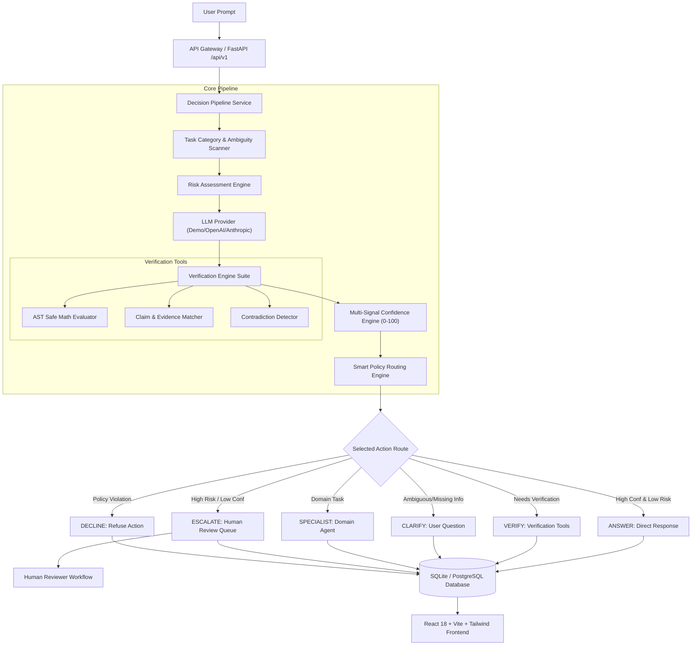

# TRUSTIQ AI System Architecture

TRUSTIQ AI is structured around a modular, 14-step trust decision pipeline designed to evaluate uncertainty, classify risk, execute modular verification, and apply configurable routing policies before responding.

## High-Level System Architecture Diagram

## Component Overview

1. **FastAPI REST API**: Handles authentication, user management, decision persistence, evaluation runs, and audit logging.
2. **Confidence Estimation Engine**: Normalizes empirical signals into a 0-100 score with explicit feature weights.
3. **Risk Assessment Engine**: Classifies operational risk independently from confidence scores.
4. **Verification Engine**: Implements AST math parsing, JSON schema validation, and contradiction detection.
5. **Human Review Queue**: Manages escalated cases with role-based reviewer approval workflows.
6. **Evaluation Laboratory**: Offline benchmark engine measuring accuracy, hallucination rate, and appropriate escalation rates.
